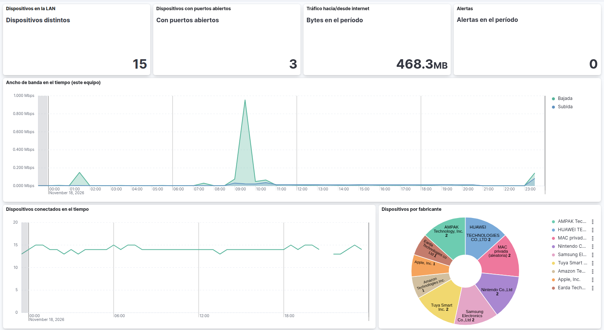
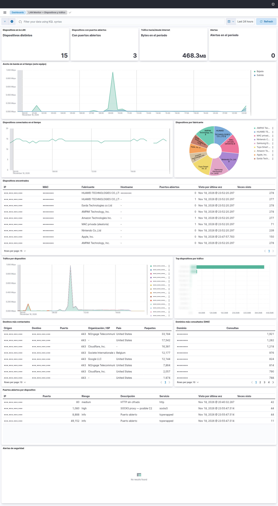
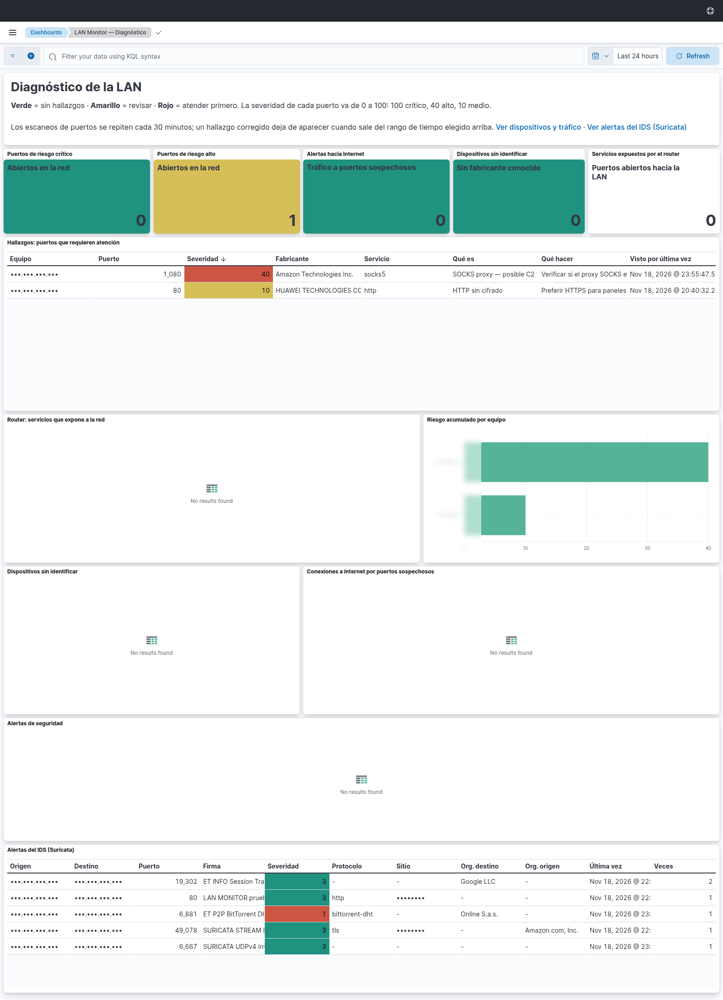
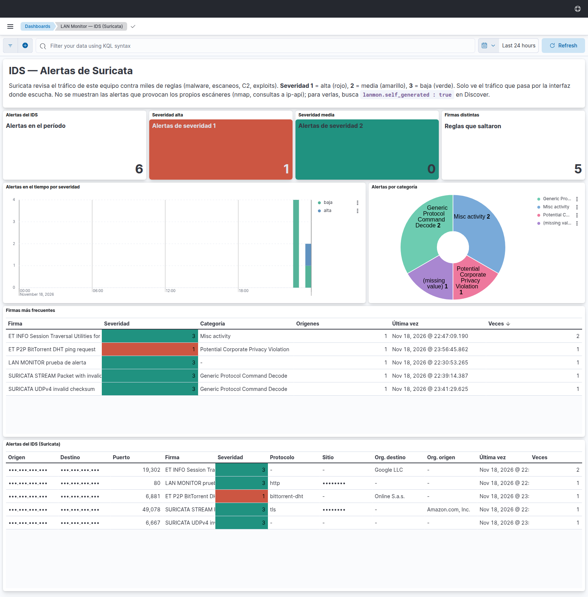

# LAN Monitor

Escanea tu red local desde contenedores Docker y muestra en Kibana qué dispositivos hay conectados, qué puertos tienen abiertos y cuánto tráfico generan.

> Úsalo solo en redes que administras. Escanear redes ajenas puede ser ilegal.



| Dispositivos y tráfico | Diagnóstico | IDS (Suricata) |
|:---:|:---:|:---:|
| [](docs/img/dashboard-trafico.png) | [](docs/img/dashboard-diagnostico.png) | [](docs/img/dashboard-ids.png) |

<sub>Capturas de una red real con IPs, MAC, hostnames y dominios ocultos. Clic para verlas completas.</sub>

## Cómo funciona

```
 scanner-devices ─┐
 scanner-ports   ─┼─► JSON en un volumen ─► Filebeat ─► Logstash ─► Elasticsearch ─► Kibana
 scanner-traffic ─┘      (lan_logs)        (junta el     (reparte en
                                            archivo)      un evento por cosa)
```

| Contenedor | Qué hace | Cada cuánto |
|---|---|---|
| `scanner-devices` | Descubre dispositivos por ARP y revisa sus 100 puertos más comunes | 5 min |
| `scanner-ports` | Escaneo de 200 puertos con nivel de riesgo por puerto | 30 min |
| `scanner-traffic` | Escucha el tráfico y guarda un resumen por host, destino y dominio DNS | 1 min |
| `filebeat` | Lee cada JSON completo y lo envía a Logstash | — |
| `logstash` | Convierte cada archivo en eventos individuales y calcula el tráfico por minuto | — |
| `elasticsearch`, `kibana` | Almacenan y grafican | — |
| `setup` | Carga la plantilla de índices y el dashboard, y termina | al iniciar |

Los escáneres usan la red del equipo (`network_mode: host`) porque necesitan ver la LAN real.

## Requisitos

- Linux con Docker y Docker Compose v2. No funciona en Docker Desktop (Mac o Windows): ahí los contenedores no ven la red local real.
- Unos 3 GB de RAM libres y 4 GB de disco para las imágenes.
- Elasticsearch necesita `vm.max_map_count` de al menos 262144. Se revisa con `sysctl vm.max_map_count`; si es menor: `sudo sysctl -w vm.max_map_count=262144`.
- Que los puertos 9200 y 5601 estén libres, o cambiarlos en `.env`.
- El sniffer solo ve el tráfico que pasa por este equipo, más broadcast y multicast del resto. Para ver todo el tráfico de la red el equipo tiene que estar en un puerto espejo del switch o ser el router.

## Puesta en marcha

```bash
cp .env.example .env
```

Revisa `LAN_TZ` (zona horaria) y, si tienes más de una interfaz de red, `LAN_IFACE`.

```bash
docker compose up -d --build
```

La primera vez descarga las imágenes de Elastic y construye la del escáner, lo que puede tardar varios minutos. Después, el arranque toma cerca de un minuto y medio. Los primeros datos de tráfico aparecen al minuto, los dispositivos a los 2–3 minutos y los puertos poco después.

Abre <http://localhost:5601> → **Dashboards** → **LAN Monitor — Dispositivos y tráfico**.

## Dashboards

Hay tres, enlazados entre sí:

- **LAN Monitor — Dispositivos y tráfico**: qué hay en la red y cuánto consume.
- **LAN Monitor — Diagnóstico**: qué habría que revisar, con severidad y acción recomendada.
- **LAN Monitor — IDS (Suricata)**: alertas de Suricata, si está instalado en el equipo.

### Dispositivos y tráfico

- Cuántos dispositivos distintos hay y cuántos tienen puertos abiertos.
- Ancho de banda en el tiempo (bajada y subida) del equipo que escanea, en Mbps.
- Dispositivos conectados a lo largo del tiempo y repartidos por fabricante.
- Tabla de dispositivos: IP, MAC, fabricante, hostname, puertos abiertos y última vez visto.
- Tráfico por dispositivo en el tiempo (Mbps) y ranking de los que más consumen (bytes).
- Destinos de internet más contactados y dominios DNS más consultados.
- Puertos abiertos por dispositivo con su nivel de riesgo.
- Alertas por puertos asociados a minería, C2 o acceso remoto sin cifrar.

### Diagnóstico

Pensado para leerse de arriba hacia abajo unos 30 minutos después de arrancar, cuando ya hubo un escaneo de puertos:

- **Semáforos**: puertos de riesgo crítico y alto, alertas hacia internet, dispositivos sin identificar y servicios que expone el router. Verde es sin hallazgos.
- **Hallazgos**: cada puerto que requiere atención, con el equipo, su fabricante, qué es y **qué hacer**. Ordenados por severidad (100 crítico, 40 alto, 10 medio).
- **Router**: los servicios que el gateway ofrece a la red.
- **Riesgo acumulado por equipo**: suma de las severidades de sus puertos abiertos.
- **Dispositivos sin identificar**: los que no tienen fabricante conocido.
- **Conexiones y alertas**: tráfico hacia internet por puertos asociados a minería, C2 o acceso remoto.

Es un diagnóstico por reglas (qué puerto está abierto y a dónde va el tráfico), no un análisis de vulnerabilidades: no prueba contraseñas ni versiones con fallas conocidas. Al final también muestra las alertas del IDS.

### IDS (Suricata)

Opcional. Si [Suricata](https://suricata.io) está instalado en el equipo, Filebeat lee su `eve.json` y envía **solo las alertas** (flujos, DNS, TLS y estadísticas se quedan en el archivo).

- Semáforos: total de alertas, de severidad alta (1) y media (2), y cuántas firmas distintas saltaron.
- Alertas en el tiempo por severidad y repartidas por categoría.
- Firmas más frecuentes y tabla de detalle: origen, destino, puerto, protocolo, sitio (HTTP Host o SNI), organización de cada lado y cuántas veces se repitió.

Puesta en marcha en el equipo:

```bash
sudo apt install suricata -y
sudo suricata-update
# En /etc/suricata/suricata.yaml, sección af-packet: la interfaz por la que sale el tráfico.
sudo systemctl restart suricata
```

Suricata solo ve el tráfico que pasa por esa interfaz: por WiFi o sin un puerto espejo en el switch, es el tráfico de este equipo y no el del resto de la LAN.

**Tráfico de los propios escáneres.** Los dashboards no muestran lo que generan las herramientas del proyecto:

- Con `LAN_SELF_IPS` definida, Logstash marca con `lanmon.self_generated` (y el motivo en `lanmon.self_reason`) las alertas de Suricata que provocan los escaneos desde ese equipo: las consultas a ip-api.com y el escaneo nmap hacia la LAN con las anomalías de protocolo que produce. Una alerta de otra categoría, o que venga de otro equipo, se sigue mostrando.
- La tabla de dominios DNS no incluye las consultas inversas (`*.arpa`), que hace el sniffer al buscar el nombre de cada IP.

Los datos no se borran: en Discover se ven con `lanmon.self_generated : true` o `dns.question.name : *.arpa`.

## Datos en Elasticsearch

Índices mensuales `lanmon-<tipo>-AAAA.MM`. El campo `event.dataset` dice qué representa cada documento:

| Índice | `event.dataset` | Un documento por | Campos principales |
|---|---|---|---|
| `lanmon-devices-*` | `devices.device` | dispositivo y escaneo | `device.ip`, `device.mac`, `device.vendor`, `device.hostname`, `device.open_ports` |
| | `devices.summary` | escaneo | `scan.device_count` |
| `lanmon-ports-*` | `ports.port` | puerto abierto y escaneo | `device.ip`, `port.number`, `port.service`, `port.risk`, `port.risk_score`, `port.recommendation` |
| | `ports.device` | dispositivo y escaneo | `device.risk`, `device.risk_score` |
| `lanmon-traffic-*` | `traffic.host` | host y minuto | `source.ip`, `traffic.delta.bytes_out`, `traffic.delta.bytes_in` |
| | `traffic.connection` | conexión del top 20 y minuto | `source.ip`, `destination.ip`, `destination.port`, `destination.scope`, `destination.as.organization.name`, `destination.geo.country_name` |
| | `traffic.dns` | dominio del top 30 y minuto | `dns.question.name`, `dns.delta` |
| | `traffic.summary` | minuto | `traffic.delta.*`, `traffic.rate.bps_in`, `traffic.rate.bps_out`, `traffic.uptime_secs` |
| `lanmon-alerts-*` | `alert` | alerta (sin duplicados) | `source.ip`, `destination.ip`, `alert.description`, `threat.category` |
| `lanmon-ids-*` | `ids.alert` | alerta de Suricata (sin duplicados) | `rule.name`, `rule.id`, `rule.category`, `event.severity` (1 alta – 3 baja), `alert.severity_label`, `source.ip`, `destination.ip`, `destination.port`, `network.transport`, `network.protocol`, `url.domain` |
| `lanmon-errors-*` | `error.json` | archivo o línea que no se pudo leer | `error.raw`, `source_file` |

Para los destinos públicos, Logstash agrega la organización o ISP dueña de la IP y el país, usando la base GeoLite2 que viene incluida en su imagen (sin consultas a internet). Los destinos de la propia red y los broadcast no llevan esos campos. En las alertas de Suricata también se completa el origen cuando es público (por ejemplo, la respuesta de un servidor).

El sniffer guarda contadores acumulados desde que arrancó. Logstash calcula la diferencia contra el minuto anterior en `traffic.delta.*`; esos son los campos que hay que sumar en los gráficos. `traffic.rate.bps_*` es ese mismo delta expresado en bits por segundo, para graficar ancho de banda. El primer snapshot después de un reinicio no trae `delta` ni `rate`. El data view de Kibana agrega los campos calculados `traffic.rate.mbps_in`, `traffic.rate.mbps_out` y `traffic.rate.mbps_total` (los mismos valores en Mbps), que es lo que muestran los gráficos.

## Configuración

Nada está fijo en el código: los escáneres leen todo de variables de entorno (`scanner/config.py`) y Docker Compose las toma de `.env`. Lo que no definas usa el valor por defecto.

| Variable | Por defecto | Qué controla |
|---|---|---|
| `LAN_TZ` | `America/Santiago` | Zona horaria de los escáneres y de Logstash |
| `LAN_IFACE`, `LAN_NETWORK`, `LAN_GATEWAY` | se detectan | Interfaz, rango a escanear y gateway |
| `LAN_ARP_TIMEOUT`, `LAN_ARP_RETRY` | `3`, `2` | Espera y reintentos del descubrimiento ARP |
| `LAN_SCAN_INTERVAL` | `300` | Segundos entre escaneos de dispositivos |
| `LAN_SCAN_TOP_PORTS`, `LAN_SCAN_HOST_TIMEOUT` | `100`, `30` | Puertos revisados y tope por host |
| `LAN_PORTS_INTERVAL` | `1800` | Segundos entre escaneos de puertos |
| `LAN_PORTS_MODE` | `fast` | `fast` o `deep` (más puertos, sistema operativo y scripts NSE) |
| `LAN_PORTS_FAST_TOP`, `LAN_PORTS_FAST_TIMEOUT` | `200`, `30` | Ajustes del modo `fast` |
| `LAN_PORTS_DEEP_TOP`, `LAN_PORTS_DEEP_TIMEOUT` | `1000`, `60` | Ajustes del modo `deep` |
| `LAN_TRAFFIC_FLUSH_SECS` | `60` | Segundos entre snapshots de tráfico |
| `LAN_TRAFFIC_TOP_CONNECTIONS`, `LAN_TRAFFIC_TOP_DNS` | `20`, `30` | Cuántas conexiones y dominios guarda cada snapshot |
| `LAN_EXTERNAL_LOOKUPS` | `false` | Consultar `api.macvendors.com` e `ip-api.com` |
| `LAN_RETENTION_MIN` | `720` | Minutos que se conservan los JSON crudos |
| `LAN_SURICATA_LOG_DIR` | `/var/log/suricata` | Carpeta del `eve.json` de Suricata que lee Filebeat |
| `LAN_SELF_IPS` | vacío | IP del equipo que escanea: las alertas de Suricata que provocan sus propios escaneos se marcan y no se grafican |
| `LAN_FILEBEAT_IGNORE_OLDER`, `LAN_FILEBEAT_CLEAN_INACTIVE` | `6h`, `7h` | Filebeat no revisa los JSON más viejos que eso al reiniciar y los olvida. Si queda caído más tiempo, lo anterior no se carga |
| `ELK_VERSION`, `ES_HEAP` | `8.13.0`, `1g` | Versión de Elastic y memoria de Elasticsearch |
| `BIND_ADDR`, `ES_PORT`, `KIBANA_PORT` | `127.0.0.1`, `9200`, `5601` | Dónde se publican Elasticsearch y Kibana |
| `LOG_MAX_SIZE`, `LOG_MAX_FILE` | `50m`, `3` | Tamaño y cantidad de archivos del log de cada contenedor |

Un valor inválido (por ejemplo `LAN_PORTS_MODE=turbo`) detiene el escáner con un mensaje claro en vez de seguir con un valor adivinado. Si la red no se puede detectar, pide definir `LAN_IFACE` y `LAN_NETWORK`.

**Privacidad:** con `LAN_EXTERNAL_LOOKUPS=false` el fabricante de cada dispositivo sale de la base local que trae nmap y nada de tu red se envía a terceros.

**Seguridad:** Elasticsearch corre sin autenticación. Por defecto solo se publica en `127.0.0.1`; no cambies `BIND_ADDR` a `0.0.0.0` en una red que no controles.

## Pruebas

Pasa archivos de ejemplo por un Filebeat y un Logstash desechables, sin tocar Elasticsearch:

```bash
python3 tests/test_pipeline.py
```

Para regenerar el dashboard después de editar `elk/kibana/build_dashboard.py`:

```bash
python3 elk/kibana/build_dashboard.py > elk/kibana/lanmon-dashboard.ndjson
```

## Limitaciones conocidas

- Las alertas se basan solo en el puerto de destino, sin distinguir TCP de UDP ni inspeccionar el contenido. El tráfico de broadcast y multicast se trata como local y no genera alertas (antes, el descubrimiento UDP de los dispositivos Tuya al puerto 6667 aparecía como "IRC C2 botnet").
- Los celulares con MAC aleatoria aparecen como "MAC privada (aleatoria)" y pueden contarse como dispositivos distintos cada vez que cambian de MAC.
- Si se cargan de golpe muchos snapshots antiguos de tráfico, llegan desordenados y no se les calcula `delta`.

## Estructura

```
scanner/        Imagen con los tres escáneres (Python + nmap + scapy) y su config.py
elk/filebeat/   Lectura de los JSON
elk/logstash/   Reparto en eventos y cálculo de deltas
elk/elasticsearch/  Plantilla de índices
elk/kibana/     Generador del dashboard y el .ndjson resultante
docs/img/       Capturas de los dashboards para este README
elk/setup/      Script que instala plantilla y dashboard
tests/          Muestras anonimizadas y prueba de la carga
```
